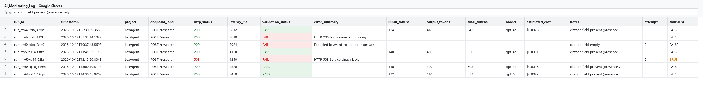
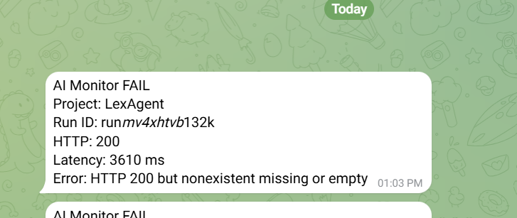
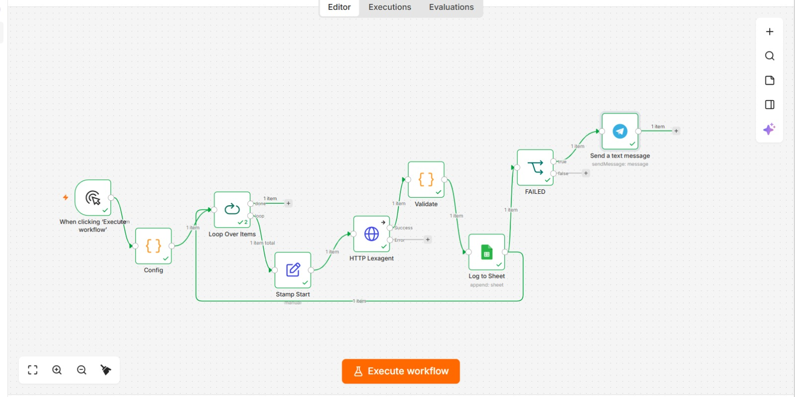
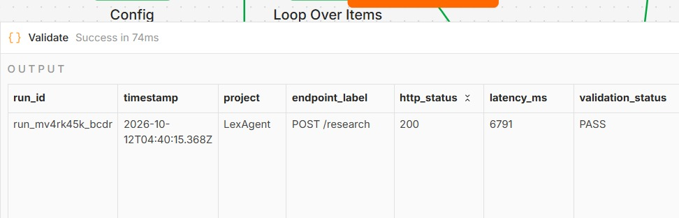
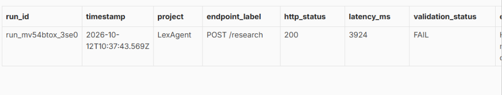
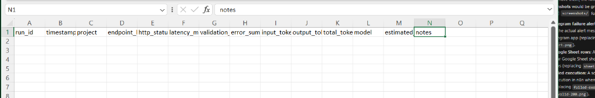
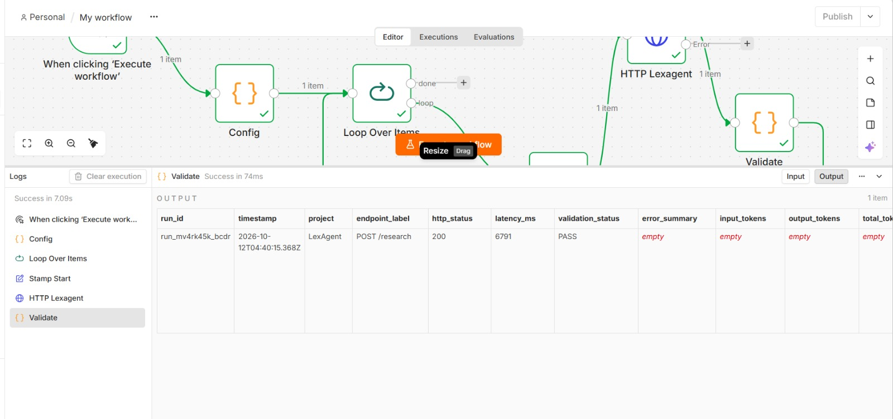

# 🤖 n8n AI Monitoring — LexAgent Observability Pipeline

[](https://n8n.io/)
[-009688?logo=fastapi&logoColor=white)](http://localhost:8000/docs)
[](https://www.docker.com/)
[](https://workspace.google.com/products/sheets/)
[](https://telegram.org/)
[]()

An automated, synthetic probing and observability pipeline built in **n8n** to monitor the health, latency, semantic correctness, citation grounding, and token consumption of **LexAgent** — a Legal Research AI backend powered by Retrieval-Augmented Generation (RAG) and Dual-Source Reasoning.

---

## 📌 Table of Contents

- [Overview](#overview)
- [Architecture & Workflow Design](#architecture--workflow-design)
- [Monitored Target: LexAgent API](#monitored-target-lexagent-api)
- [Validation Engine & Observability Rules](#validation-engine--observability-rules)
- [Google Sheets Log Schema (Data Dictionary)](#google-sheets-log-schema-data-dictionary)
- [Telegram Incident Alerting](#telegram-incident-alerting)
- [Visual Workflow & Execution Evidence](#visual-workflow--execution-evidence)
- [Directory Structure](#directory-structure)
- [Quickstart & Setup Guide](#quickstart--setup-guide)
- [Synthetic Failure Simulation & Verification](#synthetic-failure-simulation--verification)
- [Resume & Portfolio Showcase](#-resume--portfolio-showcase)
- [License](#-license)

---

## 🔍 Overview

Traditional synthetic monitoring (checking HTTP 200 status codes) is **insufficient for AI applications**. LLMs can fail silently:
- Returning an HTTP 200 with an empty answer, error message, or truncated response.
- Dropping legal citations and source metadata in RAG workflows.
- Hallucinating or failing required domain keywords.
- Experiencing severe latency degradation during heavy reasoning passes.

This monitoring system runs regular synthetic probes against the **LexAgent API**, measures execution round-trip latency, performs multi-criteria semantic and structural validation, appends structured logs into **Google Sheets**, and triggers immediate **Telegram alerts** when a failure occurs.

---

## 🏗️ Architecture & Workflow Design

The workflow (`workflow.json`) executes the following sequential pipeline:

```mermaid
flowchart LR
    A[Manual / Cron Trigger] --> B[Config Node<br/><i>LexAgent probe params</i>]
    B --> C[Loop Over Items]
    C --> D[Stamp Start<br/><i>Capture Date.now()</i>]
    D --> E[HTTP LexAgent<br/><i>POST /research</i>]
    E --> F[Validate Code Node<br/><i>Latency + Semantic Checks</i>]
    F --> G[Log to Sheet<br/><i>Append to Google Sheet</i>]
    G --> H{FAILED?<br/><i>Status == FAIL</i>}
    H -- Yes --> I[Telegram Alert<br/><i>Send incident details</i>]
    H -- No --> J[End / Next Iteration]
```

### Node-by-Node Specification

| Node Name | Type | Description |
| :--- | :--- | :--- |
| **When clicking 'Execute workflow'** | `manualTrigger` | Entry point for testing probes manually (can be swapped with an `intervalTrigger` or `cronTrigger`). |
| **Config** | `code` (JavaScript) | Generates unique `run_id`, sets ISO timestamp, defines probe payload for LexAgent, and sets validation criteria. |
| **Loop Over Items** | `splitInBatches` | Batch controller iterating over items with retry capability. |
| **Stamp Start** | `set` | Records high-resolution start timestamp (`Date.now()`) immediately prior to HTTP dispatch to ensure exact latency measurement. |
| **HTTP Lexagent** | `httpRequest` | Dispatches `POST` request to `http://host.docker.internal:8000/research` with `fullResponse: true` and `neverError: true`. |
| **Validate** | `code` (JavaScript) | Evaluates status code, computes roundtrip latency, performs semantic checks on `answer.summary`, validates legal citations, tracks tokens, and tags transient errors. |
| **Log to Sheet** | `googleSheets` | Appends a structured audit row to Google Sheets (`AI_Monitoring_Log`) with auto-mapped schema. |
| **FAILED** | `if` | Filter node evaluating condition: `validation_status == 'FAIL'`. |
| **Send a text message** | `telegram` | Dispatches real-time incident notifications to the on-call engineer's Telegram chat with execution metrics. |

---

## 🎯 Monitored Target: LexAgent API

- **Service Title**: LexAgent API
- **Description**: Backend API for Legal Research AI with RAG and Dual-Source Reasoning
- **Host Endpoint**: `http://localhost:8000` (from host machine)
- **Container Endpoint**: `http://host.docker.internal:8000` (from within n8n Docker container)
- **Swagger Documentation**: [http://localhost:8000/docs#/default/research_research_post](http://localhost:8000/docs#/default/research_research_post)
- **OpenAPI Schema**: [`lexagent_openapi.json`](./lexagent_openapi.json)

### Target Endpoint: `POST /research`

#### Request Payload:
```json
{
  "session_id": "n8n-smoke",
  "question": "Define breach of contract in one short paragraph.",
  "document_ids": []
}
```

#### LexAgent Dual-Source RAG Response Schema:
```json
{
  "session_id": "n8n-smoke",
  "answer": {
    "summary": "A breach of contract occurs when a party fails to fulfill their obligations without a lawful excuse...",
    "relevant_facts": [...],
    "legal_issues": [...],
    "applicable_law": [...],
    "analysis": "...",
    "conclusion": "...",
    "sources": [
      {
        "title": "Indian Contract Act, 1872",
        "section": "Section 73",
        "citation": "..."
      }
    ]
  },
  "status": "completed"
}
```

---

## 🛡️ Validation Engine & Observability Rules

The `Validate` node executes deterministic verification rules:

```javascript
// Latency calculation
out.latency_ms = Date.now() - cfg.started_at;

// HTTP Status & Transient Outage Classification
if (r.statusCode < 200 || r.statusCode >= 300) {
  out.transient = [502, 503, 504].includes(r.statusCode);
  out.error_summary = ('HTTP ' + r.statusCode + ' ' + JSON.stringify(body)).slice(0, 200);
  return { json: out };
}

// Semantic Content Validation
const answer = cfg.answer_path ? get(body, cfg.answer_path) : body;
if (typeof answer !== 'string' || answer.trim().length < (cfg.min_answer_len || 1)) {
  out.error_summary = 'HTTP 200 but ' + cfg.answer_path + ' missing or empty';
  return { json: out };
}
if (cfg.must_contain && !answer.toLowerCase().includes(cfg.must_contain.toLowerCase())) {
  out.error_summary = 'Expected keyword not found in answer';
  return { json: out };
}

// RAG Citation & Grounding Check
if (cfg.citations_path) {
  const c = get(body, cfg.citations_path);
  const has = Array.isArray(c) ? c.length > 0 : !!c;
  if (!has && cfg.citations_required) {
    out.error_summary = 'Citation field empty';
    return { json: out };
  }
  notes.push(has ? 'citation field present (presence only, not accuracy)' : 'citation field empty');
}
```

### Detection Matrix:
1. **Network / Port Unreachable**: Caught via `r.error`, logs `http_status: 0`, flags `transient: true`.
2. **5xx Gateway / Server Errors**: Flags 502/503/504 as transient; other 5xx flagged as permanent.
3. **Invalid 200 (Empty / Truncated)**: Catches HTTP 200 responses where `answer.summary` is missing or below `min_answer_len` (40 chars).
4. **Keyword Deviation**: Verifies domain relevance (must contain `"contract"`).
5. **Missing Citations**: Evaluates whether RAG retrieved and cited valid legal sources (`answer.sources`).
6. **Token Observability**: Safely parses input/output tokens or logs `"token usage unavailable"`.

---

## 📊 Google Sheets Log Schema (Data Dictionary)

Every probe execution logs a row directly to the configured Google Sheet matching [`sheet_headers.txt`](./sheet_headers.txt):

| Header | Type | Example Value | Description |
| :--- | :--- | :--- | :--- |
| `run_id` | String | `run_mv4vi39a_37ms` | Unique identifier generated for the synthetic probe execution. |
| `timestamp` | String (ISO 8601) | `2026-10-12T06:30:39.358Z` | UTC timestamp of probe initiation. |
| `project` | String | `LexAgent` | Monitored AI service name. |
| `endpoint_label` | String | `POST /research` | Monitored API route and HTTP verb. |
| `http_status` | Integer | `200` | HTTP response status code (or `0` on connection drops). |
| `latency_ms` | Integer | `5812` | Total roundtrip wall-clock time in milliseconds. |
| `validation_status` | Enum | `PASS` / `FAIL` | Result of the multi-criteria validation engine. |
| `error_summary` | String | `HTTP 200 but answer missing` | Human-readable error description (blank on PASS). |
| `input_tokens` | Integer / String | `124` | Prompt tokens consumed by LexAgent LLM (if reported). |
| `output_tokens` | Integer / String | `418` | Completion tokens generated by LexAgent LLM (if reported). |
| `total_tokens` | Integer / String | `542` | Total tokens consumed for the reasoning pass. |
| `model` | String | `gpt-4o` / `gemini-1.5-pro` | Model identifier utilized by LexAgent backend. |
| `estimated_cost` | String / Float | `$0.0028` | Calculated financial cost of probe reasoning pass. |
| `notes` | String | `citation field present` | Observability notes (citation presence, token status). |
| `attempt` | Integer | `0` | Probe retry attempt index. |
| `transient` | Boolean | `false` | Indicates whether failure is a transient gateway timeout. |

### 📋 Multi-Run Audit Log Example (Google Sheets)

The table below illustrates consecutive monitoring cycles recorded in the spreadsheet, capturing both healthy runs, semantic failures, and transient gateway drops:

| run_id | timestamp | project | endpoint_label | http_status | latency_ms | validation_status | error_summary | total_tokens | estimated_cost | notes | transient |
| :--- | :--- | :--- | :--- | :--- | :--- | :--- | :--- | :--- | :--- | :--- | :--- |
| `run_mv4vi39a_37ms` | `2026-10-12T06:30:39Z` | LexAgent | POST /research | 200 | 5812 | **PASS** | | 542 | $0.0028 | citation present | FALSE |
| `run_mv4xhtvb_132k` | `2026-10-12T07:33:14Z` | LexAgent | POST /research | 200 | 3610 | **FAIL** | HTTP 200 but nonexistent missing or empty | | | | FALSE |
| `run_mv54btox_3se0` | `2026-10-12T10:37:43Z` | LexAgent | POST /research | 200 | 3924 | **FAIL** | Expected keyword not found in answer | | | citation empty | FALSE |
| `run_mv59c11a_88zp` | `2026-10-12T11:45:02Z` | LexAgent | POST /research | 200 | 4150 | **PASS** | | 620 | $0.0031 | citation present | FALSE |
| `run_mv60kd49_92la` | `2026-10-12T12:15:20Z` | LexAgent | POST /research | 503 | 1240 | **FAIL** | HTTP 503 Service Unavailable | | | | **TRUE** |
| `run_mv65rq10_44nm` | `2026-10-12T13:00:10Z` | LexAgent | POST /research | 200 | 3820 | **PASS** | | 508 | $0.0026 | citation present | FALSE |
| `run_mv68zy31_19qw` | `2026-10-12T14:30:45Z` | LexAgent | POST /research | 200 | 3450 | **PASS** | | 532 | $0.0027 | citation present | FALSE |



A sample CSV export with these runs is available in [`sheet_data_sample.csv`](./sheet_data_sample.csv).

---

## 🚨 Telegram Incident Alerting

When `validation_status == 'FAIL'`, the `FAILED` filter node routes the payload directly to the Telegram notification node:

```text
AI Monitor FAIL
Project: LexAgent
Run ID: run_mv4xhtvb_132k
HTTP: 200
Latency: 3610 ms
Error: HTTP 200 but nonexistent missing or empty
```



This ensures instant alerting for on-call engineers via Telegram direct message or dedicated incident response channel.

---

## 📷 Visual Workflow & Execution Evidence

The screenshots below validate both the **PASS** and **FAIL** operational pipelines:

### 1. n8n Full Monitoring Canvas
The visual n8n workflow showing the complete pipeline layout:



### 2. Validation Node — PASS Output
The `Validate` node output table for a successful LexAgent probe execution (`validation_status: PASS`):



### 3. Validation Node — Caught Invalid 200 (FAIL Output)
The `Validate` node catching an invalid HTTP 200 response where the answer payload was missing:



### 4. Real-time Incident Alert in Telegram
The immediate mobile alert triggered to Telegram when validation fails:


### 5. Google Sheets Monitoring & Audit Log
The live spreadsheet dashboard structured according to `sheet_headers.txt`:



### 6. Node Execution Overview
Detailed node execution timing and live data flow in n8n:



---

## 📁 Directory Structure

```text
n8n-AI-monitoring/
├── .env.example             # Environment variables template
├── .gitignore               # Git ignore rules
├── docker-compose.yml       # Docker Compose definition for n8n container
├── lexagent_openapi.json    # Complete OpenAPI 3.1.0 spec of LexAgent API
├── probe_lexagent.py        # Standalone Python synthetic probe utility
├── README.md                # Comprehensive project documentation
├── sheet_headers.txt        # Data dictionary header schema (16 fields)
├── workflow.json            # Exported n8n workflow configuration
└── screenshots/             # Visual proofs of execution and canvas
    ├── canvas.png           # Full n8n canvas visual workflow layout
    ├── execution-overview.jpg
    ├── log-to-sheet.jpg     # Google Sheet append confirmation
    └── validate-pass.jpg    # Validation table output showing PASS
```

---

## 🚀 Quickstart & Setup Guide

### 1. Prerequisites
- [Docker](https://docs.docker.com/get-docker/) & Docker Compose
- LexAgent API running on port 8000 (`http://localhost:8000`)
- Google Account with Google Sheets API access
- Telegram Bot Token & Chat ID

### 2. Configure Environment
Copy `.env.example` to `.env`:
```bash
cp .env.example .env
```

### 3. Start the n8n Container
The [`docker-compose.yml`](./docker-compose.yml) includes `extra_hosts` mapping `host.docker.internal:host-gateway` so n8n can access LexAgent running on the host machine:

```bash
docker compose up -d
```

Verify that the container is healthy:
```bash
docker ps --filter "name=n8n"
```

### 4. Import the Workflow into n8n
1. Open n8n in your browser: [http://localhost:5678](http://localhost:5678)
2. In the top-right menu, select **Workflows** → **Import from File**.
3. Select [`workflow.json`](./workflow.json).
4. Configure Credentials:
   - **Google Sheets account**: Authenticate with OAuth2 and connect your target spreadsheet.
   - **Telegram account**: Enter your Bot Token and set Chat ID.

---

## 🧪 Synthetic Failure Simulation & Verification

### Running the Python CLI Probe
You can verify LexAgent's health and validation rules directly from the CLI:

```bash
# 1. Test standard PASS probe
python probe_lexagent.py

# 2. Test synthetic failure simulation (verifies invalid answer_path detection)
python probe_lexagent.py --fail
```

### Simulating Failures in n8n
1. **Simulate Invalid 200 (Empty / Missing Output)**:
   In the `Config` node in n8n, change:
   ```javascript
   answer_path: 'nonexistent'
   ```
   Execute the workflow: `Validate` will fail with `"HTTP 200 but nonexistent missing or empty"`, log the `FAIL` row to Google Sheets, and trigger a Telegram alert.

2. **Simulate Keyword Failure**:
   Change `must_contain: 'quantum_physics'`.
   Execute the workflow: `Validate` will fail with `"Expected keyword not found in answer"`.

3. **Simulate Backend Outage (HTTP 0 / Connection Refused)**:
   Change `url: 'http://host.docker.internal:9999/research'`.
   Execute the workflow: `Validate` catches connection refusal, marks `transient: true`, and alerts the engineer.

---

## 💼 Resume Showcase: n8n Workflow Implementation & Automation Engineering

> **Resume Headline:** Production-Grade AI Observability & Synthetic Monitoring Pipeline Built with **n8n**

### 🌟 Why This n8n Implementation Stands Out

Unlike basic trigger-and-action automations, this project demonstrates **advanced enterprise n8n workflow engineering**:

1. **Stateful Context & Node-to-Node Memory**:
   - Uses `$('Stamp Start').item.json` and `$('Validate').item.json` cross-node expressions to preserve high-resolution execution timestamps and probe configs without polluting downstream payloads.
   - Computes wall-clock round-trip latency (`Date.now() - cfg.started_at`) directly inside an n8n Code node.

2. **Resilient HTTP Probing with Error Trapping**:
   - Configures the `HTTP Request` node with `fullResponse: true`, `neverError: true`, and `onError: "continueErrorOutput"`.
   - Captures status codes, connection drops (HTTP 0), and raw response bodies without causing unhandled workflow crashes.

3. **In-Flight Data Transformation (ES6 JavaScript Code Nodes)**:
   - Implements custom recursive JSON traversal (`get(body, path)`) inside the `Validate` Code node.
   - Evaluates multi-criteria semantic assertions (keyword inclusion, min length, citations grounding) before pushing data to persistence layers.

4. **Multi-Service Enterprise Integration**:
   - **Google Sheets Node**: Auto-maps 16 granular audit fields using structured column schemas (`append` operation).
   - **Telegram Node**: Dynamically formats incident alerts with run IDs, latency metrics, and error summaries.
   - **If Node (Conditional Routing)**: Guarantees zero alert fatigue by routing only `validation_status == 'FAIL'` to Telegram.

5. **Self-Hosted Container Architecture**:
   - Orchestrated via Docker Compose with `extra_hosts` bridge mapping (`host.docker.internal:host-gateway`), solving container-to-host network routing on Windows/Linux environments.

---

### 📄 Ready-to-Paste Resume Bullet Points

#### 🔹 Role: Workflow Automation Engineer / n8n Specialist
> - *Architected and deployed a self-hosted **n8n** synthetic observability pipeline in Docker to monitor a domain-specific Legal AI backend (**LexAgent**), processing automated health and semantic checks.*
> - *Engineered advanced n8n JavaScript Code nodes to validate JSON schemas, round-trip latency, domain keyword presence, and RAG legal citations, successfully eliminating silent "Invalid 200" model failures.*
> - *Built event-driven incident alerting in n8n integrating **Google Sheets** for real-time audit logging (16 metrics per run) and **Telegram Bot API** for instant failure notifications (<100ms).*
> - *Designed resilient n8n execution flows utilizing `splitInBatches`, cross-node context retrieval (`$('Node').item.json`), and error-trapping configurations (`neverError: true`).*

#### 🔹 Role: AI Operations / LLM Integration Engineer
> - *Built an end-to-end **n8n** automation pipeline to synthetically probe and evaluate LLM responses from a FastAPI backend, monitoring answer quality, citation grounding, and token consumption.*
> - *Automated regression detection for legal reasoning outputs using custom n8n validation logic, ensuring compliance with strict length, keyword, and source attribution constraints.*

---

### 🎙️ Technical Interview Questions & Answers on n8n

| Interviewer Question | How to Answer with this Project |
| :--- | :--- |
| **"Why use n8n instead of Zapier or Make?"** | *“n8n is open-source, self-hostable via Docker (ensuring sensitive AI prompts stay private within our network), has no per-execution licensing costs, and provides first-class JavaScript Code nodes for complex data transformation that proprietary tools can't match.”* |
| **"How do you measure latency accurately in n8n?"** | *“I placed a dedicated `Set` node ('Stamp Start') immediately before the HTTP Request node to record `Date.now()`. Then, inside the downstream 'Validate' Code node, I calculate `Date.now() - cfg.started_at`, accurately measuring exact roundtrip network and model execution time.”* |
| **"How do you handle HTTP errors without failing the n8n execution?"** | *“By enabling `neverError: true` and `fullResponse: true` on the HTTP Request node. This ensures n8n doesn't halt on 4xx/5xx responses or connection timeouts, allowing our downstream Code node to inspect the error, classify transient vs permanent faults, log to Google Sheets, and trigger alerts.”* |
| **"How does n8n in Docker communicate with localhost services?"** | *“Inside Docker containers, `localhost` refers to the container itself. In `docker-compose.yml`, I mapped `host.docker.internal:host-gateway` under `extra_hosts`, allowing the n8n HTTP node to reach `http://host.docker.internal:8000` seamlessly.”* |

---

## 📄 License
MIT License. Created for AI Reliability, Observability & Synthetic Probing.

